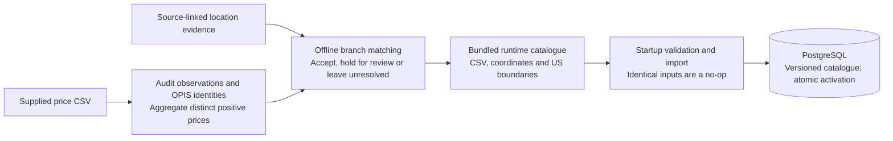
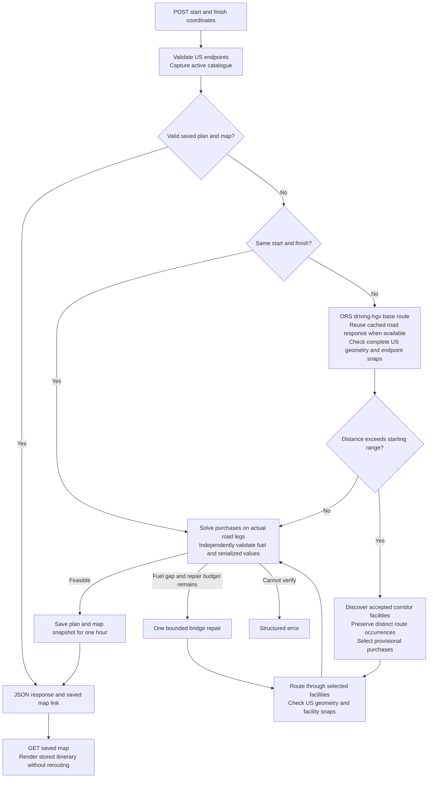

# Spotter fuel route API

A Django REST API that plans US road journeys and fuel purchases from a prepared
station price catalogue. It routes through selected facilities, calculates
partial purchases using the final road distances, and returns a map of the same
saved itinerary.

The fuel model assumes a **50 US gallon** full starting tank, **10 MPG**,
divisible purchases and zero destination reserve. Purchase cost excludes the
initial tank. The purchase calculation is optimal for the selected fixed
itinerary; route and station selection are heuristic.

[Quick start](#quick-start) · [API and example](#api) ·
[How planning works](#how-planning-works) · [Catalogue](#catalogue-and-coordinate-evidence) ·
[Evidence and limitations](#evidence-and-limitations) · [Development](#development)

## Quick start

Docker runs the application and PostgreSQL on Windows, macOS and Linux. No host
Python or PostgreSQL installation is required.

| Platform | Prerequisites |
| --- | --- |
| Windows | [Docker Desktop](https://docs.docker.com/desktop/setup/install/windows-install/) running Linux containers. |
| macOS | [Docker Desktop](https://docs.docker.com/desktop/setup/install/mac-install/) for Apple silicon or Intel, matching your Mac. |
| Linux | [Docker Engine](https://docs.docker.com/engine/install/) with the [Compose plugin](https://docs.docker.com/compose/install/linux/), or Docker Desktop. |

Start Docker and confirm `docker info` and `docker compose version` work in your
terminal. Run the following commands from the repository root.

**Windows — PowerShell**

```powershell
Copy-Item .env.example .env
```

**macOS / Linux — Terminal**

```sh
cp .env.example .env
```

Set `DB_PASSWORD` to a private local password in `.env`. Add `ORS_API_KEY` for
live routing and optionally `GEOAPIFY_API_KEY` for map tiles. Without provider
keys, the included catalogue, tests and offline demo remain available. Start
the application on any platform:

```sh
docker compose up --build -d
docker compose exec web python manage.py demo_plan
```

Startup waits for PostgreSQL, applies migrations, creates the shared cache table
and imports the included catalogue. Identical imports are no-ops on subsequent
starts. [GET /health/](http://127.0.0.1:8000/health/) checks web-process liveness.
Live routing requires an ORS credential with access to `driving-hgv`.

The offline demo makes no provider requests. Its synthetic 900-mile itinerary
has a $4 station at mile 400: 40 gallons purchased, $160 cost and zero remaining
fuel. It rolls back its database changes and uses a temporary cache; its geometry
is illustrative and its map URL is not served by the web process.

| Task | Command |
| --- | --- |
| View logs | `docker compose logs web` |
| Stop | `docker compose stop` |
| Restart | `docker compose up -d` |
| Rebuild after source changes | `docker compose up --build -d web` |

PostgreSQL persists in a named volume. Source is built into the image; runtime
data is mounted from `data/`. The local web server binds to `127.0.0.1:8000` and
uses Django's development server.

If you change provider credentials after startup, recreate the web container:

```sh
docker compose up -d --force-recreate web
```

<details>
<summary>Additional configuration</summary>

| Setting | Purpose |
| --- | --- |
| `DB_PASSWORD` | Required local PostgreSQL password. |
| `DJANGO_DEBUG` | `1` in the example for local development. |
| `DJANGO_SECRET_KEY` | Required when debug is disabled; local debug has a development fallback. |
| `DJANGO_ALLOWED_HOSTS` | Comma-separated hostnames; defaults include localhost and 127.0.0.1. |
| `ORS_API_KEY` | Server-side live routing credential. |
| `GEOAPIFY_API_KEY` | Server-side background tile credential. |
| `US_BOUNDARY_PATH` | Defaults to `data/boundaries/us.wkb`. |
| `DB_NAME`, `DB_USER`, `DB_HOST`, `DB_PORT` | Native database connection. Compose overrides name/user/host with `spotter`/`spotter`/`db`; port defaults to 5432. |

`.env`, raw research material, local Compose overrides and generated outputs are
excluded from Git and the Docker build context. The bundled runtime files are
tracked in Git and mounted into Docker. Choose the database password before first
startup; changing it later also requires changing the existing PostgreSQL login.

</details>

## API

Send `POST /api/v1/route-plan/` with `Content-Type: application/json`:

```json
{
  "start": {"latitude": 32.7555, "longitude": -97.3308},
  "finish": {"latitude": 33.749, "longitude": -84.388}
}
```

Only these named numeric fields are accepted. Strings, booleans, non-finite or
out-of-range values and extra fields are rejected. Endpoints must be within the
50 US states or DC.

| Response field | Contents |
| --- | --- |
| `plan_id`, `map_url`, `map_expires_at` | Saved plan identifier and one-hour map snapshot. |
| `route` | Final GeoJSON, road distance, legs, endpoint snaps and additional itinerary distance. |
| `visited_stations` | All selected waypoints, including facilities requiring no purchase after final routing. |
| `fuel_stops` | Positive purchases, prices, quantities, costs and tank balances. |
| `fuel` | Initial, consumed, purchased and remaining gallons; total purchase cost. |
| `assumptions`, `provenance` | Fuel model and dataset, price, algorithm, boundary and provider versions. |
| `diagnostics`, `warnings` | Routing attempts, cache hits, repair status and limitations. |

### Recorded example

The request above is the Fort Worth → Atlanta benchmark case. Its recorded run
returned an 815.95-mile final itinerary, two purchases totalling **$94.47**, and
two actual routing attempts. The following excerpt shows selected response
fields; geometry, purchases and other metadata are omitted:

```json
{
  "route": {"distance_miles": "815.953891772051"},
  "fuel": {"total_cost_usd": "94.47"},
  "diagnostics": {
    "routing_attempts_this_request": 2,
    "plan_cache_hit": false,
    "repair_used": false
  }
}
```

An immediate repeat returned the same saved itinerary with `plan_cache_hit: true`
and zero routing attempts. These are recorded results, not promises for a new
request: provider responses, catalogue versions and cache state affect planning.
Use the `map_url` from your own response; saved links expire after one hour.

Fuel quantities and prices are decimal strings. The response distinguishes fuel
consumed from fuel purchased: the initial 50 gallons are available without a
purchase charge. Purchase costs round half-up to cents; the total sums the
displayed line items.

### Map and Postman

Open `http://127.0.0.1:8000` followed by the response's `map_url`. The Leaflet viewer
displays saved geometry and purchases without rerouting. It loads Leaflet from a
CDN. Background tiles have a separate 24-hour cache and may consume Geoapify
credits; a tile failure leaves the itinerary visible. Expired snapshots return 404.

Import the collection and environment from `postman/`, then select **Spotter local**.
Run the long-route request, repeat it to inspect `plan_cache_hit`, and open
**Saved exact map**. Invalid-input and zero-distance requests are also included.
Zero-distance requests need prepared boundaries and an active dataset, but make
no routing call. Provider credentials are configured on the server, not in Postman.

### Errors

Errors contain `error.code`, `error.message`, optional safe details and `request_id`.

| HTTP status | Representative codes |
| --- | --- |
| 400 / 415 | `INVALID_INPUT`: invalid fields, JSON or content type. |
| 422 | `OUTSIDE_US`, `UNSUPPORTED_US_JURISDICTION`: unsupported endpoint. |
| 422 | `INSUFFICIENT_STATION_COVERAGE`: accepted facilities cannot bridge the projected route. |
| 422 | `NO_VERIFIED_PLAN`: final itinerary is infeasible within the repair budget. |
| 422 | `ROUTE_GEOGRAPHY_UNVERIFIED`, `STATION_ACCESS_UNVERIFIED`: geography or snap check failed. |
| 503 | `DATA_NOT_READY`, `PROVIDER_UNAVAILABLE`, `PROVIDER_QUOTA_EXCEEDED`. |
| 502 | `INVALID_PROVIDER_RESPONSE`: provider response failed validation. |
| 504 | `PROVIDER_TIMEOUT`. |
| 500 | `INTERNAL_ERROR`: unexpected application failure. |

## How planning works

`stations` handles ingestion, coordinate matching, provenance and versioned
catalogues. `planning` contains the Decimal fuel solver, independent validator,
ORS adapter, station projection, orchestration, caches and map. `config` holds
the Django settings and URL configuration. The runtime uses Django REST Framework
and PostgreSQL.

### Architecture

Location matching is an offline preparation step. Reviewer startup uses the
bundled inputs; it does not acquire coordinates or call providers.



Each request captures one active catalogue version. Routing responses and saved
plans use separate versioned caches in PostgreSQL.



Retries and repair share a maximum of three actual routing attempts and one
routing deadline. Invalid inputs, insufficient coverage or invalid provider
responses also return structured errors. Optional map tiles use a separate cache.


For an uncached journey requiring fuel purchases:

1. Validate endpoints, capture the active dataset and check the saved-plan cache.
2. Request an ORS `driving-hgv` base route with `vehicle_type: hgv` and
   `avoid_borders: all`; validate its complete geometry against the US boundary.
3. Project accepted facilities within one mile of the route, retain distinct
   occurrences on loops, and calculate purchases on projected distances.
4. Route through the selected facilities and recompute purchases using actual
   road legs. Endpoint snaps are limited to 350 metres; facility snaps to 100 metres.
5. Attempt one bridge repair for a final fuel gap if budget remains. Independently
   validate capacity, fuel conservation and serialised quantities, then save the plan.

| Request or action | Actual routing attempts |
| --- | --- |
| Zero-distance request | 0 |
| Uncached journey requiring no purchase | Usually 1 |
| Uncached journey with selected fuel facilities | Usually 2 |
| Valid saved-plan hit or opening its map | 0 |

Successful plans are cached for one hour. A cached base route can also reduce
attempts without providing a complete saved plan. Cache keys include relevant
dataset, boundary and routing-policy versions; tile requests are separate from
routing. See [the algorithm](docs/algorithm.md) for the greedy rule, worked
examples and optimality scope.

### Decisions and tradeoffs

| Decision | Reason and boundary |
| --- | --- |
| Offline, source-specific coordinate matching | A plausible point or town centre does not establish a branch. Uncertain facilities remain unavailable for planning rather than becoming fallback stops. |
| Median of distinct positive prices per OPIS identity | Duplicate rows cannot overweight a price, and the lowest observation is not automatically preferred. Unknown grade and date still limit price interpretation. |
| Project first, then route through facilities | Projection makes candidate selection practical; final road legs account for access distance. The extra routing attempt verifies the selected itinerary, not a globally cheapest route. |
| Preserve distinct occurrences on loops | The same facility can be encountered at different journey positions. Nearby stations are not merged merely because they are close. |
| Decimal purchases and independent validation | Divisible purchases avoid unnecessary full tanks; a separate simulation checks range, capacity, conservation and serialized quantities. |
| Versioned datasets and shared PostgreSQL cache | Atomic activation keeps each request on one catalogue version. Shared snapshots let requests and maps reuse the same itinerary across web processes. |
| Bounded provider work | Retries and repair share the attempt limit and deadline. Failure to establish a feasible itinerary returns an error rather than an unverified plan. |

## Catalogue and coordinate evidence

The repository includes all five runtime inputs: the supplied price CSV,
prepared station coordinates and three boundary files. No separate download,
geocoding run or private data handoff is required. Startup imports them without
external requests.

| Catalogue measure | Count |
| --- | ---: |
| Preserved source observations | 8,151 |
| US station identities | 6,626 |
| Accepted coordinates | 1,400 |
| Review-required identities | 94 |
| Unresolved identities | 5,132 |
| States with accepted facilities | 43 |

The [manifest](data/manifest.json) records SHA-256 hashes and byte sizes. Preserve
file bytes: content hashes contribute to dataset identity. New datasets activate
atomically after validation; each request retains one captured dataset version.
[Data sources and notices](data/README.md) document the input paths and their
separate provenance and licensing. Raw research material, provider caches and
credentials are excluded.

The importer preserves all source observations, including duplicates and 620
Canadian rows. Canadian rows do not become routing candidates. US OPIS identities
use the **median of distinct positive prices**, so duplicate rows cannot
overweight a price. The catalogue retains source observations and coordinate
evidence for each dataset version.

Accepted coordinates comprise 1,398 published All the Places operator-derived
records and two validated operator-directory records. Supported reference namespaces include Love's, Pilot/Flying J,
Kwik Trip/Star and Sheetz. Acceptance requires compatible branch reference,
operator, state, locality, physical address, fuel-facility evidence, supported-US
coordinates and provenance. Unproven renames, conflicting identities and shared
coordinates remain unresolved or review-required.

Acceptance under these documented rules is documentary, machine-assisted evidence;
it is not field verification or independent human verification.

## Evidence and limitations

The reference benchmark uses `fixtures/coverage-benchmark-routes.json`, the
1,400-coordinate catalogue and the explicit HGV policy above. Each case has two
requests to distinguish initial planning from cached repeats.

| Fuel-purchase journey | Final miles | Purchase cost |
| --- | ---: | ---: |
| Fort Worth → Atlanta | 815.95 | $94.47 |
| Chicago → New York | 797.19 | $98.40 |
| Los Angeles → Denver | 1,017.91 | $178.74 |
| Miami → Atlanta | 664.06 | $52.87 |
| Atlanta → Fort Worth | 816.61 | $94.67 |
| Minneapolis → Dallas | 942.51 | $138.39 |
| Detroit → New York | 618.53 | $39.20 |
| Seattle → Denver | No verified plan | Accepted-station coverage gap |

Seven of eight fuel-purchase cases succeed. Seattle–Denver has a 525.20-mile gap
between eligible accepted facilities. The separate zero-purchase controls are
Seattle–Boise (499.63 miles) and Dallas–Fort Worth (32.14 miles), both at $0.

In the reference run, successful purchase cases used two actual routing calls
initially and controls used one; successful repeats used zero. The failed
Seattle–Denver repeat reused cached base geometry and made zero calls. Results
depend on the catalogue, provider responses and cache state; a local miss does
not establish an upstream provider-cold request.

- **Coverage:** 1,400 of 6,626 US identities (21.1%) have accepted coordinates.
  This benchmark does not establish nationwide coverage, accuracy or an SLA.
- **Prices:** the supplied snapshot has unknown grade and observation date.
- **Coordinate evidence:** source rules and limited documentary inspection
  establish acceptance, not a field survey. Source addresses do not prove a match
  to CSV highway-exit text, and some fuel tags originate in collector logic.
- **Access:** provider waypoints do not verify individual pumps. HGV routing does
  not establish legal clearance for a particular truck's dimensions or weight.
- **Optimisation:** purchase quantities are optimal on the selected fixed itinerary.
  Route/stop selection is heuristic; additional facilities can increase road distance
  and cost.

### Performance and metrics

| Measured operation | Observed time |
| --- | ---: |
| Fresh purchase-plan HTTP response, two separate journey comparisons | **2.11–2.21 s** |
| Cached repeats in the same experiment | **28–33 ms** |

The planner skips unnecessary station projections and reuses one request-scoped
provider connection. Cached repeats make zero routing calls. These limited local
samples include network/provider variation and establish neither a production
percentile nor an SLA. See [performance verification](docs/performance.md) for
the comparison method, baseline timings and identical-response checks.

## Development

Run checks on any platform with Docker:

```sh
docker compose exec web pytest -q
docker compose exec web ruff check .
docker compose exec web ruff format --check .
docker compose exec web python manage.py check
docker compose exec web python manage.py makemigrations --check --dry-run
```

Tests use synthetic data and mocked providers; ordinary checks need no provider
keys. Representative coverage connects the tests to the guarantees:

| Behavior or invariant | Tests |
| --- | --- |
| Partial purchases, exact range edges and seeded exhaustive solver comparisons | [`test_fuel.py`](tests/test_fuel.py) |
| Distinct route occurrences and station projection | [`test_geometry.py`](tests/test_geometry.py) |
| Final-road repair and visited facilities requiring no purchase | [`test_planner.py`](tests/test_planner.py) |
| Branch conflicts, source evidence and coordinate collisions | [`test_atp_matching.py`](tests/test_atp_matching.py), [`test_operator_matching.py`](tests/test_operator_matching.py) |
| Observation preservation, import rollback and idempotency | [`test_ingestion.py`](tests/test_ingestion.py), [`test_importing.py`](tests/test_importing.py) |
| Provider budgets, client lifecycle, safe errors and saved maps | [`test_provider.py`](tests/test_provider.py), [`test_routing_client.py`](tests/test_routing_client.py), [`test_api.py`](tests/test_api.py), [`test_hardening.py`](tests/test_hardening.py) |

These checks complement the recorded live benchmark; mocked-provider tests do
not establish nationwide coverage or live provider availability.

Preview the benchmark with `docker compose exec web python manage.py benchmark_routes`.
Add `--live` to run it against the routing provider; this consumes provider allowance.
The command retains caches and writes timings, query counts, attempts and failures
to ignored `data/cache/benchmark.json`.

<details>
<summary>Explicit catalogue import and boundary maintenance</summary>

Docker startup already imports the bundled catalogue. To request an explicit
import:

```sh
docker compose exec web python manage.py import_fuel_data data/raw/fuel-prices.csv data/enriched/stations.json
```

Prepared boundaries are included. If rebuilding them, download the official
[Census TIGER2025 state archive](https://www2.census.gov/geo/tiger/TIGER2025/STATE/tl_2025_us_state.zip)
to `data/raw/tl_2025_us_state.zip`, then run:

```sh
docker compose exec web python manage.py prepare_us_boundaries data/raw/tl_2025_us_state.zip
```

</details>

<details>
<summary>Optional native setup</summary>

Install Python 3.13 and PostgreSQL. Create a `spotter` database with a login able
to create test databases. Create a virtual environment from the repository root:

**Windows — PowerShell**

```powershell
py -3.13 -m venv .venv
.\.venv\Scripts\Activate.ps1
Copy-Item .env.example .env
```

**macOS / Linux — Terminal**

```sh
python3.13 -m venv .venv
. .venv/bin/activate
cp .env.example .env
```

Configure the database credentials in `.env`, then use the same commands on all
platforms from the activated environment:

```sh
python -m pip install -r requirements.txt
python manage.py migrate
python manage.py createcachetable
python manage.py import_fuel_data data/raw/fuel-prices.csv data/enriched/stations.json
python manage.py runserver 127.0.0.1:8000
```

For import, demo and checks, omit `docker compose exec web` from the commands above.

</details>

Attribution: routes © openrouteservice / HeiGIT; basemap © Geoapify and
OpenStreetMap contributors; boundaries from the US Census Bureau. Leaflet uses
BSD-2-Clause. Operator-derived coordinates retain All the Places source provenance.
The supplied assessment CSV and prepared catalogue are included; source-specific
notices are in [data/README.md](data/README.md).
